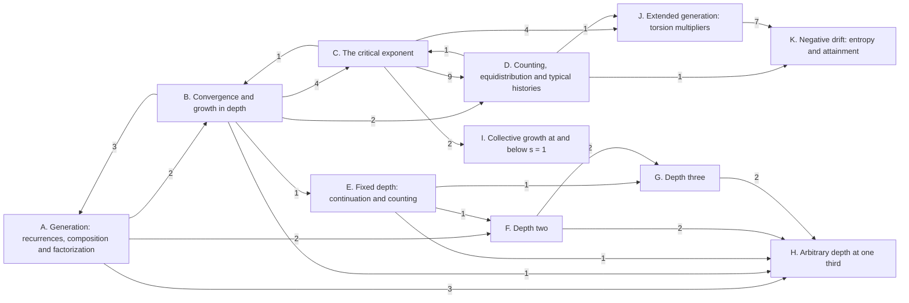

# Dependency architecture

130 nodes and 175 edges, recorded from explicit citations (exact meaning in `DEPENDENCIES.json`). The graph is a lower bound: an uncited use does not appear.

## Most relied-upon results

| Result | Title | Direct uses | All results resting on it | Review |
|--|--|--|--|--|
| ANS-T15 | Source-one generation: every prime reached; saturation | 5 | 57 | V |
| ANS-T17 | Infinite-alphabet admissibility obstruction | 2 | 55 | V |
| ANS-T03 | Source and endpoint recurrences | 8 | 41 | V |
| ANS-T23 | Rate of critical decay up to logarithms | 8 | 41 | V |
| ANS-T12 | Convergence region at fixed depth | 4 | 35 | V |
| ANS2-L1 | Source formula in extended grammars | 5 | 26 | V |
| ANS-T32 | Fixed-depth counting asymptotic and the constants kappa_k | 4 | 25 | VQ |
| ANS2-T14 | One-letter formula for any signs | 3 | 25 | V |
| ANS2-T02 | Positive drift: depth bounds and abscissa | 4 | 23 | V |
| ANS-T18 | Divergence of minimal sources | 2 | 22 | V |
| ANS-T34 | Every G_k is meromorphic on Re s > 1/3 | 5 | 22 | V |
| ANS2-L2 | Comparison of torsion classes | 1 | 20 | V |

## Reviewed results resting on results without a review verdict

0 of 124 reviewed results have such an ancestor in the recorded graph. In v001, before the foundational audit, the count was 63 of 91. The graph records cited uses only.

## Links between regions

An arrow from X to Y means that results in region Y cite results in region X; the label counts the citations.

## Entries citing no earlier result

AS-001, AS-002, ANS-T03, ANS-T01, ANS-T02, ANS-T06, ANS-T08, ANS-T07, ANS-T15, ANS-T16, ANS-T17, ANS-T32, ANS-T45e, ANS-T46c, ANS-T46d, ANS-T46o, ANS2-T00, ANS2-L1, ANS2-T01, ANS2-T06, ANS2-T14, ANS2N-T12a, ANS-T28.
